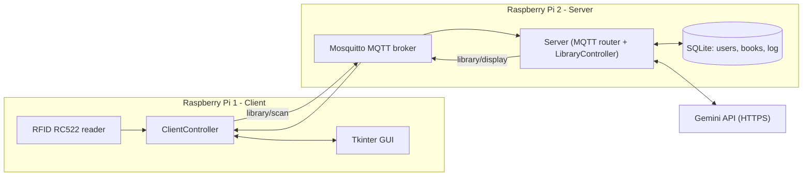

# Smart Library System (IoT Project)

A smart library terminal built with **MQTT** and two Raspberry Pis. Readers log in by scanning an **RFID card**, borrow and return books by scanning the book's tag, and get **AI book recommendations from the Gemini API** based on their interests. Admins get an activity log.

*University IoT project, Wrocław University of Science and Technology.*

---

## Features

- **RFID login:** readers and books each have an RFID tag; scanning identifies them
- **AI recommendation on login:** the system asks Gemini for a book matching the reader's stored interest
- **"AI Librarian" chat:** readers can ask for a book in free text
- **Borrow / return flow:** choose an action, then scan the book (one book per reader, availability checks)
- **Admin view:** role-based screen with the last 50 system actions (logins, views, borrows, returns)
- **Non-blocking AI calls:** login is instant, and the recommendation arrives asynchronously
- **PC simulation mode:** runs without RFID hardware, with on-screen buttons that simulate scans

---

## System Architecture



| Device | Role | Components |
|---|---|---|
| **Raspberry Pi 1** | Client | Touchscreen / HDMI display, RFID-RC522, Tkinter GUI |
| **Raspberry Pi 2** | Server | Mosquitto broker, SQLite database, Gemini API calls |

### MQTT messages (JSON)

| Direction | Topic | Message |
|---|---|---|
| Client → Server | `library/scan` | `action`: `scan`, `borrow`, `return`, `chat`, `get_logs`, `logout` |
| Server → Client | `library/display` | `type`: `login`, `chat_response`, `action_confirm`, `log_data` (or an error status) |

---

## How the AI recommendations work

1. After a reader logs in, the server reads their **interest** from the database.
2. It builds a prompt containing the full **book catalog** (id, title, description) plus the request ("Recommend a book about *interest*").
3. The prompt asks Gemini (`gemini-2.5-flash`, called over its REST API) to pick **one book ID** from the catalog and give a reason of at most 10 words, returned as strict JSON:

```json
{ "id": "<book_id>", "reason": "<max 10 words>" }
```

4. The server parses the JSON and **looks the ID up in the database**, so the book shown always comes from the real catalog.
5. If the API fails or returns something invalid, the UI shows a fallback message instead of crashing.
6. The call runs in a **background thread**, so the reader sees the dashboard immediately ("Loading...") and the recommendation updates when it arrives.

The **AI Librarian** chat tab sends free-text requests through the same pipeline.

---

## Tech stack

- **Language:** Python 3
- **Messaging:** MQTT (`paho-mqtt`, Mosquitto broker)
- **GUI:** Tkinter
- **Database:** SQLite (auto-created and seeded with sample users and books)
- **AI:** Google Gemini API (`gemini-2.5-flash`) via `requests`
- **Hardware:** 2x Raspberry Pi, RFID-RC522 (`mfrc522`, `spidev`, `RPi.GPIO`)

---

## Project structure

```
SmartLibrary/
├── Raspberry1/              # Client
│   ├── main.py              # Tkinter app
│   ├── ui_views.py          # Login, dashboard, admin and scan popup views
│   ├── client_controller.py # MQTT client + UI logic
│   └── hardware.py          # RFID reader (falls back to simulation on PC)
├── Raspberry2/              # Server
│   ├── main.py              # MQTT subscriber and message router
│   ├── controller.py        # Login, borrow/return, chat, sessions
│   ├── database.py          # SQLite queries
│   ├── ai_service.py        # Gemini prompt and response handling
│   └── init_db.py           # Schema and sample data
└── common/
    └── config.py            # MQTT topics, DB path, environment variables
```

---

## Hardware prerequisites

### Raspberry Pi 1 (Client)

- Raspberry Pi (any model with a 40-pin header)
- Touchscreen or HDMI monitor
- **RFID-RC522 module**, wired as follows (physical pin numbers):

| RC522 pin | Raspberry Pi pin |
|---|---|
| SDA | 24 |
| SCK | 23 |
| MOSI | 19 |
| MISO | 21 |
| RST | 22 |
| GND | GND |
| 3.3V | 3.3V |

### Raspberry Pi 2 (Server)

- Raspberry Pi with internet access (required for the Gemini API)

### Network

- Both Pis must be on the **same network**
- *Tip:* university Wi-Fi may isolate devices. Use a mobile hotspot if needed.

---

## Setup

### Phase 1: Common setup (both Pis)

1. Copy the project to `/home/pi/SmartLibrary` on **both** Raspberry Pis.
2. Install Python dependencies:

```bash
sudo apt update
sudo apt install python3-pip
pip3 install paho-mqtt requests python-dotenv
```

### Phase 2: Server setup (Raspberry Pi 2)

1. Install and start the Mosquitto MQTT broker:

```bash
sudo apt install mosquitto mosquitto-clients
sudo systemctl enable mosquitto
sudo systemctl start mosquitto
```

2. Mosquitto 2.x only accepts local connections by default. To let the client Pi connect over your **trusted local network**, create `/etc/mosquitto/conf.d/lan.conf`:

```
listener 1883
allow_anonymous true
```

then run `sudo systemctl restart mosquitto`.

3. Create a `.env` file in the project root (`/home/pi/SmartLibrary/.env`):

```
GEMINI_API_KEY=your_api_key_here
MQTT_BROKER=localhost
MQTT_PORT=1883
```

4. Get the server's IP address (needed for the client):

```bash
hostname -I
```

### Phase 3: Client setup (Raspberry Pi 1)

1. Enable SPI: run `sudo raspi-config`, then **Interface Options → SPI → Enable**, and reboot if prompted.
2. Install the hardware libraries:

```bash
pip3 install mfrc522 spidev RPi.GPIO
```

3. Create a `.env` file in the project root (`/home/pi/SmartLibrary/.env`), using the server IP from Phase 2:

```
MQTT_BROKER=192.168.1.50
MQTT_PORT=1883
```

### Phase 4: Run

**Always start the server first.**

```bash
# Raspberry Pi 2 (server)
cd /home/pi/SmartLibrary/Raspberry2
python3 main.py
# Expected: SERVER LISTENING ON: library/scan
```

```bash
# Raspberry Pi 1 (client)
cd /home/pi/SmartLibrary/Raspberry1
export DISPLAY=:0   # only needed when connected over SSH
python3 main.py
```

On first run the server creates `library.db` with 5 sample readers (one admin) and 5 sample books.

---

## Run on a PC (no hardware needed)

The RFID library is optional: if it isn't installed, the client switches to **simulation mode** and shows buttons that act like card scans.

1. Install a Mosquitto broker on your computer.
2. Install the dependencies: `pip install paho-mqtt requests python-dotenv`
3. Create a `.env` in the project root with `GEMINI_API_KEY=...` (get a key from Google AI Studio). `MQTT_BROKER` defaults to `localhost`.
4. Start the server (`cd Raspberry2`, then `python main.py`) and the client (`cd Raspberry1`, then `python main.py`).
5. Click **[Sim] Alice** (admin) or **[Sim] Bob** (reader) to log in, then try the AI Librarian tab and the borrow/return buttons.

---

## Project status

Working: RFID login, MQTT client-server messaging, SQLite persistence, borrow/return flow, admin log view and AI recommendations.

**Possible improvements**

- Send only *available* books to the AI (currently the whole catalog is sent)
- Return several ranked recommendations instead of one
- Use borrowing history, not only the stored interest
- Add MQTT authentication and TLS

---

## Notes

- `.env` files hold secrets and are excluded with `.gitignore`. Never commit your API key.
- The sample users and books are fictional.
- This is an educational project and is not licensed for production use.

## Author

Francisco Barrientos. [LinkedIn](https://www.linkedin.com/in/fbarrientos1/)
